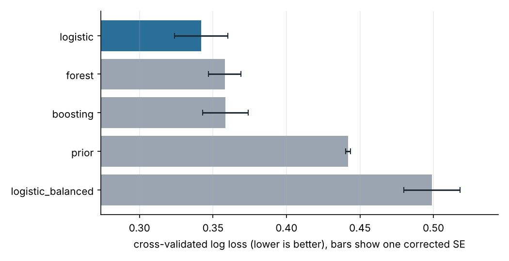
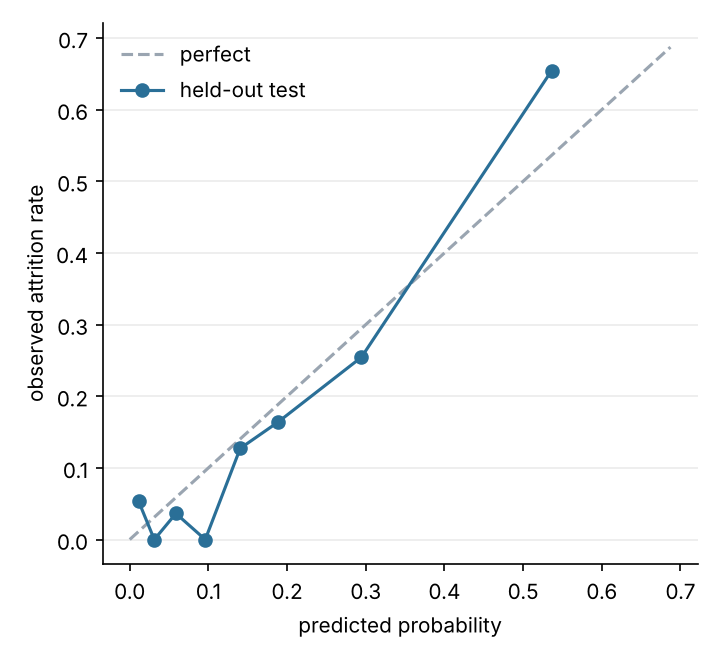
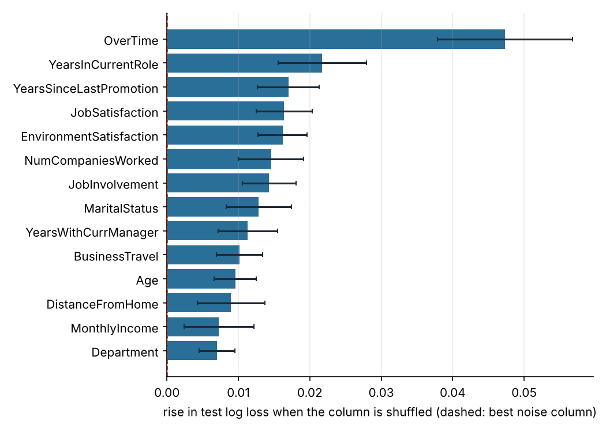
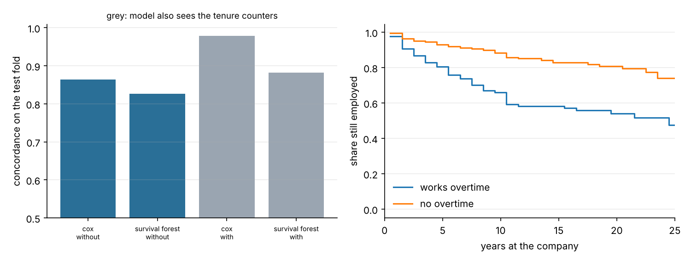
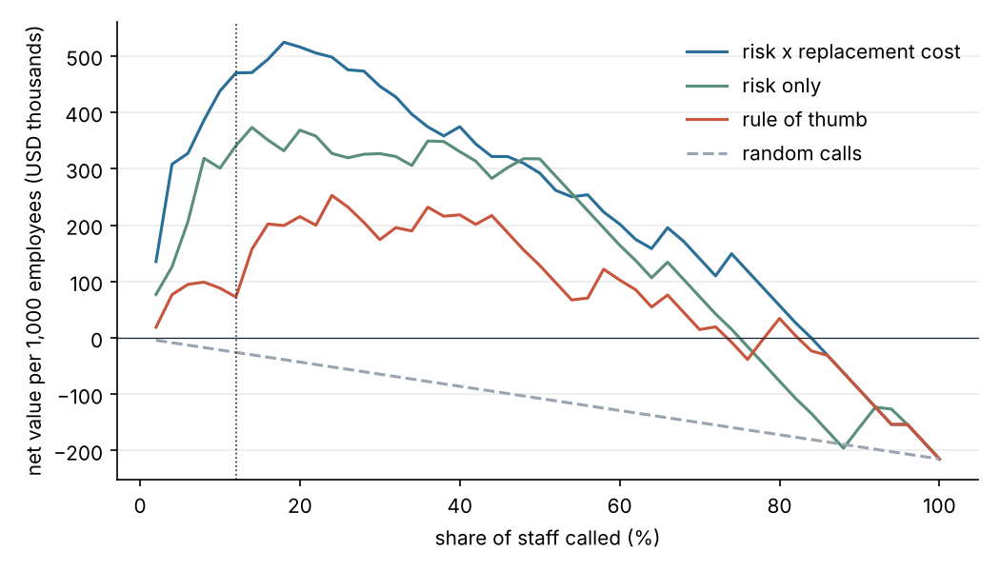

# stayline

[](https://github.com/ranjithguggilla/stayline/actions/workflows/ci.yml)

Attrition risk for a 1,470-person workforce, plus the question managers actually have to answer: with time for only a handful of retention conversations, who gets one?

I built this around a small, well-known HR table. Small data is where model comparisons go wrong most easily, so most of the repo is evaluation discipline rather than modelling: repeated cross-validation with a corrected standard error, a one-standard-error selection rule, shuffled-noise columns as an importance floor, a survival-analysis cross-check that exposes a leak, and a dollar model with its assumptions written down.

## Results

Data: 1,470 employees, 237 leavers (16.1%). Stratified split into 1,029 training and 441 test employees (71 test leavers). Everything below was measured by `stayline` and is stored in `outputs/metrics.json`.

### Model comparison (5x5 repeated CV on the training fold)

| model | CV log loss | corrected SE | CV AUC | CV ECE |
|---|---|---|---|---|
| logistic (L2, inner CV for C) | 0.3421 | 0.0181 | 0.813 | 0.066 |
| random forest | 0.3580 | 0.0110 | 0.795 | 0.070 |
| boosting | 0.3586 | 0.0155 | 0.776 | 0.055 |
| logistic, class-weight balanced | 0.4990 | 0.0191 | 0.808 | 0.222 |
| prior only | 0.4419 | 0.0017 | 0.500 | 0.060 |

The plain logistic model has the best mean and is also the simplest, so the one-standard-error rule picks it with no argument. Reweighting classes (balanced) keeps the ranking (AUC 0.808) but ruins the probabilities: ECE jumps from 0.066 to 0.222 and log loss ends up worse than predicting the base rate. Since the downstream decision depends on calibrated risk, I did not reweight.



### Held-out test fold (touched once)

| metric | value |
|---|---|
| AUC | 0.8553 (95% bootstrap CI 0.801 to 0.905) |
| log loss | 0.3142 (0.264 to 0.370); prior-only 0.4413 |
| average precision | 0.6575 (base rate 0.161) |
| ECE | 0.0485 |
| top 20% of scores | precision 0.523, recall 0.648, lift 3.25 |
| manager checklist (overtime, single, low pay, no options, short tenure) | AUC 0.7477 |

Boosting scored 0.8153 AUC and the forest 0.7948 on the same fold, so the choice made on training data held up.



### What drives the score

Shuffling a column and watching test log loss rise, next to four columns of pure noise added at fit time: the noisiest of those moved log loss by 0.00005. 14 of the 30 real columns clear that floor by more than two standard deviations. Overtime is far ahead (0.047), followed by years in the current role (0.022), years since the last promotion (0.017), job satisfaction (0.016) and environment satisfaction (0.016). The three pay-rate columns (daily, hourly, monthly rate) sit at the noise floor, which fits the folklore that they were generated independently of everything else.



Dropping a group of columns and rerunning CV (change in log loss, with a corrected 95% interval):

| dropped | change in log loss | interval |
|---|---|---|
| tenure counters | +0.0076 | -0.0012 to +0.0165 |
| pay-rate columns | -0.0014 | -0.0070 to +0.0042 |
| age, gender, marital status | +0.0058 | -0.0013 to +0.0129 |

Nothing here is distinguishable from zero. I kept all 30 features, but it also means a version without age, gender and marital status costs very little, which is worth knowing if a fairness review asks for it.

### Survival cross-check

The same file also describes time at the company, so I fitted Cox and random survival forests on `YearsAtCompany` (leavers have an event, current staff are censored).

| model | features | concordance | AUC against the exit flag |
|---|---|---|---|
| Cox | without tenure counters | 0.864 | 0.815 |
| survival forest | without tenure counters | 0.826 | 0.790 |
| Cox | with tenure counters | 0.979 | 0.725 |
| survival forest | with tenure counters | 0.882 | 0.775 |

Giving Cox the other tenure counters lifts concordance from 0.864 to 0.979 while its ability to flag leavers gets worse (0.815 to 0.725). Those counters are partly the duration being predicted, so the high number is bookkeeping, not skill. Five years in, 75.9% of employees who work overtime are still employed against 92.0% of those who do not.



### Retention calls and money

Assumptions, all mine and none from the dataset: replacing someone costs 50% of annual pay, one retention intervention costs $1,500 (manager time plus an offer), and 25% of would-be leavers who get one stay. Average replacement cost on the test fold is $40,493.

The call budget was chosen on out-of-fold training scores (12% of staff), then priced on the test fold: 53 people called, 28 of the 71 leavers reached (39.4%).

| policy at a 12% budget | net per 1,000 employees | 95% interval |
|---|---|---|
| risk x replacement cost (shipped) | $469,881 | $246,977 to $697,992 |
| risk only | $340,857 | $185,828 to $473,376 |
| manager checklist | $72,405 | -$3,249 to $213,173 |
| random calls | -$25,778 | -$67,035 to $16,786 |
| call everyone | -$214,816 | -$558,624 to $139,886 |
| hindsight ceiling | $977,755 | $718,590 to $1,233,698 |

At a flat 20% budget the ordering is the same: $515,810, $368,398, $215,041 for the three real policies. Weighting risk by what the person would cost to replace is worth about $129k per 1,000 employees over ranking on risk alone, though the intervals overlap. The list breaks even at a 6.9% save rate; at 5% the program loses $50k per 1,000, at 10% it makes $80k, at 40% it makes $860k.



Who the list reaches (test fold):

| group | employees | leavers | share called | share of leavers reached |
|---|---|---|---|---|
| female | 177 | 21 | 10.7% | 33.3% |
| male | 264 | 50 | 12.9% | 42.0% |
| single | 154 | 37 | 16.9% | 48.7% |
| married | 206 | 27 | 8.3% | 29.6% |
| divorced | 81 | 7 | 12.3% | 28.6% |
| under 30 | 95 | 27 | 12.6% | 33.3% |
| 30 to 44 | 249 | 33 | 11.7% | 42.4% |
| 45 and over | 97 | 11 | 12.4% | 45.5% |

With 7 to 50 leavers per row these gaps are noisy. Gender and marital status are in the model, so this table is the one to read before using it.

### Reasons in plain words

For each employee the app swaps one field at a time for the typical value and reports the biggest drops in risk (for a single employee on $2,800 a month with no stock options and five years since a promotion: "works overtime = Yes (raises risk by 23.1 points vs a typical employee)"). As a check I compared the top three reasons against LIME on 40 test employees: mean overlap (Jaccard) 0.46. They agree about half the time on the exact set, which is why I treat reasons as conversation starters and not as findings.

## Architecture

```
 data/hr_attrition.csv
          |
          v
   load + clean (drop constants, id)
          |
          v
   stratified split --------------> test fold (scored once)
          |
          v
   5x5 repeated CV: logistic | forest | boosting | prior | balanced
          |  (all transforms inside the pipeline)
          v
   one-SE rule --> shipped model
          |
   +------+--------------+----------------+
   |                     |                |
   v                     v                |
 ablations,            Cox / survival      v
 noise-floor           forest cross-   out-of-fold scores
 importance            check              |
                                          v
                              budget + policy table (dollars)
          |
          v
 outputs/metrics.json, tables, charts, bundle.joblib --> Gradio app
```

## Installation

```bash
git clone https://github.com/ranjithguggilla/stayline.git
cd stayline
python -m venv .venv && source .venv/bin/activate
pip install -r requirements.txt
pip install -e . --no-deps
```

Python 3.11 or newer. I developed on 3.13.

## Usage

1. Run the whole pipeline (about 90 seconds on a laptop CPU):

   ```bash
   stayline
   ```

2. Read the numbers in `outputs/metrics.json` and the tables in `outputs/tables/`. Charts land in `assets/`.
3. Start the scoring app:

   ```bash
   stayline-app
   ```

4. Fill in a few fields (overtime, pay, role, tenure and so on). Anything left alone defaults to the typical employee. The app returns the probability, a risk band, replacement cost, the expected value of a call and the reasons.
5. To check that a rerun reproduces the committed numbers:

   ```bash
   cp outputs/metrics.json /tmp/before.json
   stayline
   python -m stayline.verify /tmp/before.json outputs/metrics.json
   ```

## Configuration

Dollar assumptions live in `src/stayline/config.py` (`Costs`): `replacement_share_of_annual_pay`, `cost_per_conversation` (a full retention intervention), `save_rate` and the default `budget_fraction`. Seeds, split size, CV folds and repeats and the bootstrap count are in the same file. Change them and rerun; nothing else is hard-coded.

## Output structure

```
outputs/
  metrics.json          every number quoted above
  bundle.joblib         fitted model, defaults, band thresholds (not committed)
  tables/
    cv_comparison.csv   fold-averaged CV scores with corrected SE
    test_scores.csv     all models on the test fold
    ablation.csv        drop-a-group study
    importance.csv      permutation importance with noise columns
    survival.csv        Cox and forest concordance
    policies.csv        call policies at the chosen budget
    policies_at_20pct.csv
    group_audit.csv
assets/                 charts used in this README
```

## Project structure

```
src/stayline/
  config.py       paths, seeds, cost assumptions
  data.py         loading, split, survival arrays
  models.py       pipeline builders
  metrics.py      ECE, bootstrap, corrected SE, lift
  evaluate.py     CV comparison, one-SE rule, ablation, noise importance, survival
  economics.py    replacement cost, policies, budget curves, break-even
  score.py        score_employee and the swap-based reasons
  app.py          Gradio interface
  plots.py        charts
  pipeline.py     end-to-end run
  verify.py       metrics drift check used by CI
tests/            pytest suite
data/             the source csv
```

## Technical details

- Preprocessing (scaling, one-hot encoding) sits inside each scikit-learn pipeline, and the logistic model picks its own regularisation by inner CV, so no fold ever sees data it should not.
- Cross-validation is 5-fold stratified, repeated 5 times. Folds overlap, so the plain standard error is too small; I use the Nadeau-Bengio correction for every interval on CV scores.
- Model choice is the simplest candidate within one corrected standard error of the best log loss. Prior-only and class-balanced logistic are reference rows and cannot be shipped.
- Survival durations are `YearsAtCompany + 0.5` because tenure is recorded in whole years and some people have zero.
- The shipped bundle is refit on training and test together after all evaluation is done. Its band cut points (60th and 90th percentile of out-of-fold risk) are 0.139 and 0.400.
- Library versions are pinned in `requirements.txt`.

## Limitations

The data is a fictional sample released by IBM, so the absolute rates say nothing about a real company. There are no dates, so I cannot test forward in time, and for leavers the tenure fields were frozen at exit. The 25% save rate is an assumption; the sweep above shows how much the answer depends on it.

## Testing

```bash
pip install -r requirements-dev.txt
ruff check src tests
pytest -q --cov=stayline
```

44 tests, about 69% line coverage (the end-to-end `pipeline.py` is exercised by CI's training job rather than by unit tests). Ruff is clean. CI runs lint and tests on every push, and on main it reruns the whole pipeline, compares the headline metrics to the committed ones and uploads the outputs as an artifact.

## Dataset

IBM HR Analytics Employee Attrition and Performance, a fictional dataset by IBM data scientists, originally published on Kaggle: https://www.kaggle.com/datasets/pavansubhasht/ibm-hr-analytics-attrition-dataset. The copy in `data/` comes from https://github.com/pplonski/datasets-for-start (MIT licensed).

## License

MIT, see `LICENSE`.
